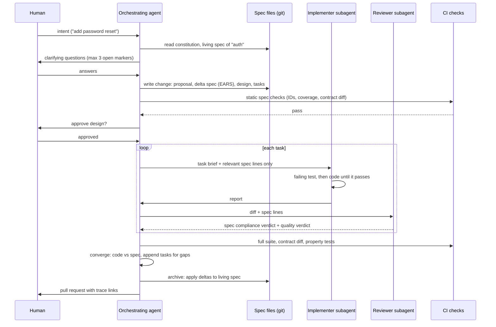

# Spec-driven development for coding agents, end to end

## Summary
**TL;DR:** Spec-driven development (SDD) means writing a structured description of the behaviour you want before a coding agent writes code, and using it to guide and check the work. Six toolkits (Spec Kit, OpenSpec, Kiro, BMAD-METHOD, Superpowers, AWS AI-DLC) share one skeleton:
- an always-loaded context or constitution file;
- a requirements spec (WHAT and WHY);
- a design (HOW);
- a task plan;
- a verification step;
- for existing code, change records written as deltas.

They differ mainly in how long a spec stays authoritative and in how its match with the code is checked. The evidence so far:
- specs pay off for features and multi-file changes, not for small bug fixes;
- executable specs (tests, properties, contracts) beat prose on long tasks;
- the common failures are review overload, specs nobody maintains, and agents that drift from the spec.

**Use this when:** designing an SDD process or framework for coding agents; choosing between the toolkits; deciding how much spec a change needs; adopting SDD on an existing codebase; checking a claim about SDD tools, standards or results.
**Depth:**
- the three axes that classify SDD approaches;
- the artifact layers and the standards behind each (ISO/IEC/IEEE 29148, EARS, ISO/IEC/IEEE 42010, C4, arc42, ADRs, Design by Contract, SemVer);
- the lifecycle of every toolkit, step by step, with its gates and anti-drift checks;
- iterative and brownfield patterns (walking skeleton, spikes, delta specs, characterization tests, Strangler Fig, Branch by Abstraction, Parallel Change, Anti-Corruption Layer);
- contract evolution and breaking-change tools;
- the change-size ladder;
- reusing one Spec Kit setup across many repositories (presets, bundles, hooks, and template sync with Copier);
- discovery before `specify`: what Spec Kit already records, and the standard terms for scale, quality and component questions;
- two worked examples and the measured case studies;
- reference tables, a failure matrix, misconceptions, and open questions.

## 1. Mental model

**Definition.** A spec is a structured, behaviour-oriented artifact, written in natural language, that describes what the software must do and guides a coding agent ✅[^68]. Spec-driven development is any workflow in which such a spec is written before the code and then used to steer and check the agent's work.

**Analogy.** A spec is the architect's drawing set for a house. The builder (the coding agent) works from it, and the inspector (tests and reviewers) checks the building against it. What makes the approaches differ is what happens to the drawings after the house is built:
- thrown away;
- kept and amended for every renovation;
- or treated as the only thing anyone edits, with the house rebuilt from them each time.

Spec Kit's own statement of the method calls this a reversal of the usual order: "Specifications don't serve code—code serves specifications" ✅[^1].

**Concrete artifact.** In GitHub Spec Kit, one feature produces `specs/003-user-auth/spec.md` (what and why). Then `/speckit.plan` and `/speckit.tasks` add `plan.md`, `research.md`, `data-model.md`, `contracts/` and `tasks.md` next to it ✅[^6].

### Three axes that classify every approach

| Axis | Positions | Source |
|---|---|---|
| **Level**: how long the spec stays authoritative | *Spec-first*: written for one task, then left behind. *Spec-anchored*: kept and evolved with the feature. *Spec-as-source*: humans edit only the spec, and code is generated from it | Böckeler, 15 Oct 2025, the earliest source found for the three terms ✅[^68] |
| **Retention**: what happens to the spec after delivery | A living spec, an accumulated change record, or discarded after implementation | Agarwal et al., study of 470,795 spec files in 73,030 repositories ✅[^58] |
| **Formality**: how checkable the spec is | Free prose → semi-formal (EARS sentences, Given/When/Then, pre- and postconditions) → executable (tests, properties, contract files, model checks) | Synthesis of this doc; the strongest measured gains sit at the executable end (§4.3) |

Böckeler found that every approach she examined is spec-first, but not all aim to be spec-anchored or spec-as-source ✅[^68]. A vendor benchmark of four toolkits in 2026 reached the same conclusion: all four worked at the spec-first level ✅[^73].

### What SDD is not

- **Not a context file.** `AGENTS.md`, `CLAUDE.md` and Kiro steering files hold rules for every session. A spec holds the intent of one feature or change ✅[^68]. `AGENTS.md` itself is "just standard Markdown" with no schema: a README for agents, not a spec format ✅[^21].
- **Not graph orchestration.** SDD governs *what* must be built and how to prove it. Orchestration governs *how work runs*. [Graph Engineering, SDD, AI-DLC, and Spec Kit](graph-engineering-vs-sdd-ai-dlc-spec-kit.md) covers that split.
- **Not new.** Design by Contract put specifications at module boundaries in 1992 ✅[^33]. Model-driven development (MDD) tried spec-as-source with UML (Unified Modeling Language) diagrams and domain-specific languages. Böckeler warns that spec-as-source built on large language models (LLMs) may inherit both MDD's inflexibility and LLM non-determinism ✅[^68]. Large up-front specifications followed by time-boxed increments are also a documented historical form of iterative development, for example the 1972 Trident submarine project ✅[^55].
- **Not one product.** GitHub announced Spec Kit on 2025-09-02 ✅[^74]. Kiro, OpenSpec, BMAD, Superpowers and AI-DLC grew in parallel, and they change fast (§6.2).

### Where it sits among agent disciplines

A spec is a *guide* in harness-engineering terms: it steers the agent before it acts. Tests, linters and review agents are the *sensors* that check afterwards. See [Harness engineering](harness-engineering-deep-dive.md). Context-window limits explain why every toolkit loads only part of the spec set per step; see [Context engineering](context-engineering-deep-dive.md).

## 2. Concept architecture

Every toolkit studied uses the same eight layers of artifacts, though under different names. The Diátaxis column applies the four documentation types (tutorial, how-to, reference, explanation) ✅[^32]. That mapping is this doc's inference, not a statement from diataxis.fr: the site's pages, read on 2026-11-22, say nothing about specifications ⚠️ unverified.

| # | Layer | Answers | Diátaxis form (inference) | Spec Kit | OpenSpec | Kiro | BMAD 6.12 | Superpowers | Standards behind it |
|---|---|---|---|---|---|---|---|---|---|
| L0 | Context, constitution | Which rules apply to every change? | Reference | `.specify/memory/constitution.md` | `config.yaml` (optional) | `.kiro/steering/*.md`, `AGENTS.md` | project context | the skills themselves | AGENTS.md format |
| L1 | Requirements | What and why? | Reference | `spec.md` | `openspec/specs/<domain>/spec.md` | `requirements.md` or `bugfix.md` | `prd.md`, `SPEC.md` | design doc | ISO/IEC/IEEE 29148, EARS, Gherkin |
| L2 | Architecture, design | How, structurally? | Explanation + reference | `plan.md`, `research.md`, `data-model.md` | `design.md` per change | `design.md` | `ARCHITECTURE-SPINE.md` | design doc | ISO/IEC/IEEE 42010, C4, arc42, IEEE 1016 |
| L3 | Decisions | Why this option and not the others? | Explanation | complexity tracking in `plan.md` | `design.md` | `design.md` | architecture doc | rulings in the ledger | Nygard ADR, MADR |
| L4 | Contracts | What exactly crosses each boundary? | Reference | `contracts/` | (in specs) | (in design) | (in architecture) | interfaces block in the plan | OpenAPI, AsyncAPI, Protobuf, Design by Contract, SemVer |
| L5 | Plan, tasks | What do I do next, in which order? | How-to | `tasks.md` | `tasks.md` per change | `tasks.md` | stories | `plans/<date>-<feature>.md` | dependency graphs, Cockburn increments |
| L6 | Verification evidence | How do we know it matches? | Reference | checklists, converge report | verify report | property-based tests | QA, code review | two-verdict task review | 29148 "verifiable", property-based testing, approval tests |
| L7 | Change records | What changed, when, and why? | Reference (history) | feature folders | `changes/` and `changes/archive/` | one spec per feature | implementation record | dated plans | ADR superseding rules, delta specs |

Sources for the toolkit columns:
- Spec Kit ✅[^6]; OpenSpec ✅[^7]; Kiro ✅[^11][^14]; BMAD ✅[^18]; Superpowers ✅[^19].
- AI-DLC keeps the same layers per *intent*: a state file plus an append-only audit log ✅[^24].

Kiro's three foundation steering files are:
- `product.md` (purpose, users, objectives);
- `tech.md` (frameworks, constraints);
- `structure.md` (file layout, naming conventions).

They are loaded into every interaction by default ✅[^14]. `AGENTS.md` has been stewarded by the Agentic AI Foundation under the Linux Foundation since 2025-12-09 ✅[^22]. Its convention is that the file closest to the edited file wins, and explicit chat prompts override every file ✅[^21].

### Requirements layer: what the standards add

- **ISO/IEC/IEEE 29148:2018** (requirements engineering) sets nine characteristics for every single requirement (clause 5.2.5):
  - necessary, appropriate, unambiguous, complete, singular;
  - feasible, verifiable, correct, conforming.

  It sets five more for a set of requirements (5.2.6): complete, consistent, feasible, comprehensible, able to be validated ⚠️[^25]. A complete set has no "to be defined" placeholders left. A requirement's ID is never changed or reused. "Shall" marks a binding requirement ⚠️[^25]. The standard is being revised: a draft of edition 3 was in ballot in 2026 ⚠️[^25].
- **EARS** (Easy Approach to Requirements Syntax), from Rolls-Royce, fixes the clause order: `While <precondition>, when <trigger>, the <system> shall <response>`. It has five base patterns plus combinations of them (§5.1). A requirement has at most one trigger and exactly one system name ✅[^26]. The 2009 conference paper describes five templates ✅[^54].
- **Gherkin** writes acceptance examples as `Rule`, `Example` and `Given/When/Then` steps ✅[^44]. OpenSpec uses `### Requirement:` with a SHALL sentence, followed by `#### Scenario:` blocks ✅[^8].

### Architecture and decision layers

- **ISO/IEC/IEEE 42010** is the meta-model under every architecture document. Stakeholders have *concerns*. A *viewpoint* defines one kind of *view* that frames chosen concerns. *Correspondences* link elements across views. Decisions carry their *rationale* ✅[^27].
  - Analogy: the legend and index of an atlas.
  - For SDD, correspondences are the trace links: requirement ↔ component ↔ task ↔ test ↔ decision.
- **C4** (Simon Brown) gives four zoom levels: system context, container, component, code. Context and container diagrams are enough for most teams. A "container" is any runtime unit (web app, mobile app, CLI, database), not a Docker container ✅[^28].
- **arc42** gives a 12-section skeleton for architecture documents, with decisions in section 9 ✅[^29].
- **Architecture Decision Records (ADRs).** Nygard's 2011 format has Title, Context, Decision, Status and Consequences. There is one decision per record. A reversed decision is kept and marked superseded, never deleted, and numbers are never reused ✅[^30]. MADR 4.0.0 adds Considered Options and a *Confirmation* field that says how compliance with the decision is checked ✅[^31].

### Authority between layers

The toolkits name an order of authority, so an agent knows which artifact wins when two disagree:
- **Superpowers:** "The spec is the binding authority, the plan is its argument" ✅[^20].
- **Spec Kit's "living spec" model:** `spec.md` is the contract, and plan and tasks are derived from it ✅[^3]. Spec Kit's plan template runs a constitution gate before research and again after design ✅[^6].
- **BMAD:** only the `bmad-spec` skill may write `SPEC.md`. It keeps capability IDs stable across edits ✅[^18].

Synthesis (this doc): read together, these sources give the order: constitution > requirements > contracts and design > tasks > code. The ADR log explains decisions but does not outrank the documents those decisions changed.

## 3. How it works

### 3.1 The shared pipeline

All six toolkits run some version of these nine steps. Optional steps are in brackets.

1. **Set the context once.** Write the constitution or steering files from evidence in the repository.
2. **State intent.** Write the requirements: what and why, no technology choices.
3. **[Clarify]** the open questions with the human.
4. **Design.** Plan the architecture, contracts and decisions.
5. **[Check the spec set statically]** for consistency and coverage.
6. **Split into tasks.** Each task is small enough for one fresh agent context.
7. **Implement** task by task, test first.
8. **Verify** the code against the spec, including what the agent may have skipped.
9. **Merge the record.** Archive deltas into the living spec, or close the feature folder.

How each toolkit spells the steps:

| Toolkit (version) | Command or phase chain | Source |
|---|---|---|
| Spec Kit 1.4.3 | `/speckit.constitution` → `specify` → [`clarify`] → `plan` → [`checklist`] → `tasks` → [`analyze`] → `implement` → `converge` | ✅[^2] |
| OpenSpec 2.1.1 | [explore] → propose → apply → [verify] → sync → archive. Its stated philosophy is "actions, not phases" | ✅[^9] |
| Kiro | requirements (or bug analysis) → [analyze requirements] → design → tasks, with a review gate between phases; Quick Spec runs all three without gates | ✅[^11] |
| BMAD 6.12 | define intent → `bmad-spec` → story breakdown (for an epic) → `bmad-build` per story → retrospective against the parent spec | ✅[^17][^18] |
| Superpowers 7 | brainstorming (approved design doc) → git worktree → writing-plans → subagent-driven development with test-driven development → whole-branch review → finish | ✅[^19][^20] |
| AI-DLC 2.11 | Initialization → Ideation → Inception → Construction → Operation; 33 stages, each except Initialization ending in a human approval gate | ✅[^23] |

In Spec Kit only `specify` is required before `plan`. Clarify, checklist and analyze are quality gates for work with real ambiguity ✅[^2].

### 3.2 Gates before code

| Gate | What it blocks | Toolkit |
|---|---|---|
| At most 3 `[NEEDS CLARIFICATION: …]` markers in a spec; clarify resolves them | Guessing instead of asking | Spec Kit ✅[^6] |
| Read-only cross-artifact `analyze` report | Inconsistent spec, plan and tasks; it never edits files | Spec Kit ✅[^2] |
| `implement` counts unchecked checklist items and asks before going on | Starting work on an unreviewed spec | Spec Kit ✅[^2] |
| Review gate after each phase | Design on unapproved requirements | Kiro ✅[^11] |
| Human approval of the design doc ("hard gate") | Any code before the design is approved | Superpowers ✅[^19] |
| Approval at the end of each stage | The next stage | AI-DLC ✅[^23] |

### 3.3 Execution discipline

Superpowers gives the most explicit rules for running tasks with agents:
- **A fresh subagent per task**, given a brief written for it. Subagents never inherit the session's history, and are never asked to read the whole plan ✅[^20].
- **One implementer at a time.** Implementation subagents are never run in parallel, to avoid conflicts ✅[^20].
- **A task is "the smallest unit that carries its own test cycle and is worth a fresh reviewer's gate"** ✅[^19]. The plan lists the interfaces each task shares with its neighbours ✅[^19].
- **A two-verdict review per task.** The reviewer reports spec compliance (missing work and extra work) and task quality separately ✅[^20].
- **A ledger file** tracks progress, because conversation memory does not survive context compaction ✅[^20].

BMAD sizes one implementation session as one goal: about 500 lines added or changed, in a handful of files ✅[^17]. It also warns that splitting work can lose information. A requirement weakens, a constraint disappears, or two correct stories fail when combined ✅[^18].

### 3.4 Anti-drift checks: does the code still match the spec?

| Mechanism | How it works | Limits | Source |
|---|---|---|---|
| Spec Kit `converge` | Compares code with spec, plan and tasks. Treats existing checkmarks as unverified ("completion claims are not evidence"). Can only append tasks. Repeats until it reports "Converged" | Append-only: it cannot fix spec errors | Compare, append-only, repeat ✅[^2]; the checkmark rule and its quote, from the converge command template ✅[^6] |
| OpenSpec archive | Applies a change's deltas to the living spec in the order RENAMED → REMOVED → MODIFIED → ADDED | `verify` is advisory and does not block archive | ✅[^8][^9] |
| Kiro property-based tests | Extracts properties from EARS requirements, generates many random inputs, shrinks a failure to the smallest input | Opt-in; "evidence of correctness, not a proof" | ✅[^13] |
| Kiro Sync Files | Creates tasks for changed requirements and marks tasks that existing code already completes | Manual trigger | ✅[^15] |
| Tessl `status` (historical) | A "dirtiness" check for code and tests out of sync with specs | Removed with the Tessl Framework on 2025-11-14 | ✅[^16] |
| AI-DLC Guard Policy | Blocks completion when a change is uncovered or a unit is stale; every decision is audited | Heavy machinery | ✅[^24] |
| Superpowers review | The reviewer lists missing and extra work against the spec | Costs one review per task | ✅[^20] |

When a property-based test fails, the error may be in the code, the test or the spec:
- In the original QuickCheck work, the bugs found were split roughly evenly between test-data generators, specifications and programs ✅[^43].
- Kiro likewise offers to fix the spec, the code or the test ✅[^13].

So a failing check needs triage. An agent should not silently rewrite whichever artifact is nearest.

### 3.5 What happens to the spec after delivery

- **Spec Kit** offers four models and makes none the default:
  - flow-back;
  - flow-forward;
  - living spec;
  - constitution-only.

  Its own repository tracks only the constitution and gitignores `specs/` ✅[^3].
- **OpenSpec** keeps one living spec per capability. Every change is a folder of *delta specs* that archive merges in ✅[^7]. Deltas let two changes edit the same spec file without conflict, as long as they touch different requirements ✅[^7].
- **In practice**, retention splits three ways (living spec, change record, discard), and most real use is spec-first ✅[^58].

### 3.6 Iterating: increments, rework, skeletons, spikes

- **Incremental and iterative are different things.** Incremental development stages and integrates parts over time. Iterative development schedules rework. Cockburn's common failure is "they forget to iterate" ✅[^45]. In his model the first increment is a full vertical slice from the user interface to the back end ✅[^45].
  - Analogy: incremental is adding rooms to a house one at a time; iterative is going back to repaint and rewire the rooms already built.
- **Uncontrolled iteration fails too.** In Cockburn's Project Baker, anyone could change requirements or design at any time ✅[^45]. For SDD, this means requirement changes go through the spec at planned examine points.
- **Tracer bullets** are kept, production-quality code that runs end to end. Prototypes are throwaway ✅[^46].
- **Spikes** are short, throwaway experiments that answer one technical question ✅[^47]. Agent spikes are cheap, so the risk shifts from cost to leakage: throwaway code that ends up shipped.

### 3.7 Brownfield: SDD on an existing codebase

**Spec only the change.**
- Spec Kit does not infer specs for existing behaviour, and its first spec in an existing repository describes the intended change ✅[^4].
- It also warns against inventing standards to fill the constitution template ✅[^4].
- OpenSpec says the same and builds the living spec one change at a time ✅[^10].

**Bug fixes get a three-part spec.**
- Kiro's `bugfix.md` replaces `requirements.md` with three parts ✅[^12]:
  - current behaviour (`WHEN … THEN the system …`);
  - expected behaviour (`… SHALL …`);
  - unchanged behaviour (`… SHALL CONTINUE TO …`), which is tested as well.
- Spec Kit's bug extension splits the work into assess → fix → test. It requires the original reproduction to be re-run, because a passing suite alone is not enough ✅[^5].

**Pin behaviour before changing it.**
- Approval testing: the agent produces received output, and a human approves it into the approved file. Scrubbers mask non-deterministic values ✅[^53].
- The full method for code with no tests is in [Characterization tests for code that has none](../testing/characterization-tests.md).

**Displacement patterns** (choose by situation, §5.10):

| Pattern | What it does | Source |
|---|---|---|
| Strangler Fig | Small additions beside the legacy system, then behaviour moves over through seams. Fowler notes that much existing behaviour is not wanted, so "rebuild what it does" specs are a trap | ✅[^48] |
| Feature Parity | Replicating the legacy system like-for-like. Its authors generally do not recommend it | ✅[^49] |
| Transitional Architecture | Code that exists only to let old and new coexist, removed later | ✅[^50] |
| Branch by Abstraction | Put an abstraction in front of an internal library, move callers onto it, switch the implementation behind it, delete the old one; the build stays green at every step | ✅[^51] |
| Parallel Change (expand → migrate → contract) | Backward-incompatible interface or schema change in three releasable phases. Skipping the contract phase leaves the system worse than before | ✅[^67] |
| Anti-Corruption Layer | A translation layer that keeps a legacy model's meanings out of a new context | ✅[^52] |

### 3.8 Contracts and how they evolve

- **Who is wrong when a check fails.** A failed precondition is a bug in the caller. A failed postcondition is a bug in the routine ✅[^33].
  - An agent triaging a red test can use this to decide what to fix.
  - Meyer's subcontracting rule ("weaken the precondition or strengthen the postcondition") defines a compatible redefinition ✅[^33]. Applying it to API versions is this doc's synthesis.
- **Declare the public API.** SemVer's first rule is that software "MUST declare a public API". MAJOR changes when that API breaks, MINOR for compatible additions and deprecations, PATCH for compatible fixes ✅[^34].
- **Diff tools check shape, not meaning.**
  - oasdiff marks changes it cannot confirm from the spec as warnings ✅[^36].
  - `buf breaking` separates source-level from wire-level breakage, but only by structure ✅[^37].
  - Hyrum's Law: with enough users, every observable behaviour is depended on by somebody, whatever the contract promises ✅[^35]. A clean contract diff still needs a judgement on behaviour changes.
- **Consumer-driven contracts.** Pact fits integrations where one organisation controls both sides. It is not for public APIs, provider functional tests or performance ✅[^42].

Formats per interface kind are in [Interface description standards](../documentation/interface-description-standards.md). The breaking-change tools per kind are in §5.8.

### 3.9 Scaling ceremony to the change

| Change | Path | Source |
|---|---|---|
| Typo or obvious one-line edit | No spec; a direct edit the human reviews | Kiro ✅[^15]; BMAD ✅[^17] |
| Bug | Bugfix spec (current, expected, unchanged); re-run the reproduction | Kiro ✅[^12]; Spec Kit ✅[^5] |
| Small, clear feature | Short path: one spec, no gates between phases | Kiro Quick Spec ✅[^11]; BMAD light path ✅[^17] |
| Multi-session feature | Parent spec, then a sequence of one-session units | BMAD ✅[^17] |

BMAD routes a change on three facts about the settled design ✅[^17]:
- intent gaps (things the human did not say but would notice in the result);
- irreversible actions;
- footprint.

A design clean on all three takes the light path. Any flag means a written plan first.

### 3.10 One full pass, actor by actor

The sequence below combines the gates of §3.2 and the execution rules of §3.3 into one feature change. It is this doc's composite; each step is taken from a toolkit cited above.



### 3.11 Cross-artifact interactions

What a change in one artifact forces on the others:

| Changed artifact | Effect on the others | Source |
|---|---|---|
| Constitution | Spec Kit versions it with SemVer and writes a temporary "Sync Impact Report" (version change, modified principles, added and removed sections) for human review of the amendment | ✅[^6] |
| Requirement | Kiro Sync Files adds tasks; OpenSpec writes a MODIFIED block holding the full new requirement, not a diff | ✅[^15][^8] |
| Requirement ID | Never reused or changed, so links from tests and code stay valid | ⚠️[^25] |
| Accepted ADR | Not edited; a new ADR supersedes it and the old one is marked | ✅[^30] |
| Public contract | Diff against the baseline, then a MAJOR bump if it breaks; consumers re-verify (Pact) | ✅[^34][^42] |
| Code changed by hand | OpenSpec asks for hand edits to be reconciled before archive, because archive makes the specs the record of truth | ✅[^9] |
| Plan or task | Never overrides the spec; reviewers flag "extra" work | ✅[^20] |

### 3.12 Reusing one Spec Kit setup across many repositories

Two different things get reused, with two different tools:
- **the process**: templates, commands, gates and automation. Spec Kit packages these itself.
- **the starting code**: build files, CI, lint config, folder layout. Spec Kit does not package code. A project-template tool does.

Analogy: the process is the franchise's operations manual, the starting code is the shop fit-out. A new branch gets both, but the manual is revised far more often than the walls are rebuilt.

**Spec Kit's building blocks,** with the job each one is for ✅[^79].

| Block | What it changes | Where it lives | Source |
|---|---|---|---|
| Project-local override | One template, in one project | `.specify/templates/overrides/` | ✅[^79] |
| Preset | Format or wording of existing templates and commands, the core's and the extensions' | Installed per project; several stack by priority | ✅[^79][^80] |
| Extension | New commands, templates, scripts and hooks | Installed per project | ✅[^79] |
| Workflow and overlay | A multi-step automation. An overlay edits an installed workflow's steps without touching its file, so it survives updates | `.specify/workflows/overlays/<id>/*.yml` | ✅[^82] |
| Bundle | One versioned set of extensions, presets, workflows and step types for a role or team. It adds no behaviour of its own | `bundle.yml` | ✅[^81] |

**Rules that matter when many repositories share one setup:**
- **Resolution order.** Project override, then presets, then extensions, then core ✅[^80].
  - Within a layer, the lower priority number wins.
  - A layer can `replace`, `prepend`, `append` or `wrap` the content below it. Scripts allow only `replace` and `wrap` ✅[^80].
  - Example: a team-wide preset at priority 10 and an HTTP-API preset at priority 5 that appends a contracts section to `plan-template`.
- **Commands are copied at install time.** They are written into the agent's command folder when a preset or extension is installed. The agent does not re-resolve the stack on each call ✅[^80].
- **The constitution is seeded once.**
  - `specify init` writes it from the resolved template.
  - Later preset changes do not rewrite it, unless the `constitution-sync` preset is enabled.
  - Even then, a hand-edited constitution is protected ✅[^80].
- **Pinning.** `specify preset add --from <archive-url>` installs one release archive ✅[^80].
- **Updates are not upgrades in place.**
  - `specify preset update` removes the preset, then adds it again. It has no version comparison and no `--version` flag. If the add fails, nothing is rolled back. Local edits inside the installed preset folder are lost ✅[^80].
  - `specify bundle update <id>` reapplies the components the bundle owns. It is not one transaction either: a later failure does not undo earlier changes ✅[^81].
- **Hooks.** Hook events run before and after every core command, `converge` included, and around the bug commands (`before_bug_assess`, `after_bug_test` and so on) ✅[^82]. The bundled `bug` extension's commands are `speckit.bug.assess`, `speckit.bug.fix` and `speckit.bug.test` ✅[^86].

**Starting code:**
- **A GitHub template repository is a one-time copy.** The new repository starts with a single commit and an unrelated history, so no pull request or merge can run between it and the template ✅[^84]. Later template changes do not reach it.
- **Copier keeps the link.**
  - It stores the answers given at generation in `.copier-answers.yml`.
  - `copier update` reads the template's git tags, orders them by PEP 440 (Python's version-ordering rules), checks out the latest one and re-applies the project's answers.
  - A hunk it cannot place is left as an inline conflict marker (the default) or in a `.rej` file, for a person to resolve ✅[^85].
  - Files listed in `skip_if_exists` are created once and never overwritten by an update ✅[^85].
  - A version is picked with `--vcs-ref <tag>` on `copier copy` or `copier update`; the template argument itself is a local path, a URL or a shortcut such as `gh:namespace/project` ✅[^85].

**How Spec Kit runs its own lifecycle,** in its own docs ✅[^83].
- It separates three kinds of work:
  - **regular automation:** tests, lint, CodeQL and releases in ordinary GitHub Actions;
  - **agent automation:** feature assessment and bug triage, started when a maintainer applies a label;
  - **human decisions:** which work starts, and what merges.
- Generated `specs/` folders are normally gitignored. One substantial feature (the bundler) kept its spec, plan and tasks as a historical snapshot.
- Its own bug-assess, bug-fix and bug-test repository workflows do not yet use the bundled `bug` extension. That is described as future work.

**A community fork that adds a learning loop.**
- `tikalk/agentic-sdlc-spec-kit` adds a `--team-ai-directives <url|path>` option to `specify init`. It wires in a separately versioned repository of rules, personas, examples and skills ✅[^87].
- Its `levelup` command turns a finished session into a Context Directive Record (CDR), which is contributed back to that repository ✅[^87].
- Its `specify self check` and `specify self upgrade` point to the fork's own releases, not to upstream ✅[^87].
- On 2026-11-22 its latest release was `agentic-sdlc-v1.0.4+adlc3` (2026-09-11). Upstream Spec Kit was at v1.4.3 (2026-11-19) ✅[^87][^111].

### 3.13 Discovery: from a vague request to a confirmed architecture

A request such as "build a role-based access control app" leaves open the purpose, the scale, the quality targets, the components and the stack. Discovery is the questioning that closes those gaps before `specify`. Analogy: an architect's first meeting with a client, before any drawing.

**What Spec Kit already provides:**
- **The `assess` extension** (bundled, opt-in) runs five stages: intake → research → define → shape → decide ✅[^88].
  - It writes `intake.md`, `research.md`, `problem.md`, `concept.md` and `decision.md` under `.specify/assessments/<slug>/`.
  - It ends with a `go`, `needs-clarification` or `kill` verdict.
  - Detailed architecture is deliberately outside it, and the handoff to `/speckit-specify` is a manual step ✅[^88].
- **`/speckit.clarify` keeps a question-and-answer record** ✅[^89].
  - It scans the spec against a fixed list: functional scope, domain and data, non-functional quality attributes, integration, edge cases, constraints and trade-offs, terminology, completion signals.
  - It asks at most 5 questions, one at a time.
  - Each accepted answer is written as `- Q: <question> → A: <answer>` under `## Clarifications` / `### Session YYYY-MM-DD`, then applied to the matching section of the spec.
- **Terminology is already checked by two commands** ✅[^89][^104]:
  - `clarify`'s list includes "Terminology & Consistency" with "canonical glossary terms". A conflicting term is normalized across the spec, keeping the old name once as "formerly referred to as".
  - `analyze` reports "terminology drift" (the same concept named differently across files) at MEDIUM severity.
  - `specify`, `clarify` and `analyze` all load `/memory/constitution.md`, so a principle written there reaches every agent that runs them ✅[^89][^104].
- **"Spec of specs" breaks a large piece of work into slices** ✅[^90]. A roadmap file (`specs/<epic>/roadmap.md` or `ROADMAP.md`) gives each slice a stable id, its intent, a scope boundary, dependencies and a status. No special tooling is involved.
- **Each integration puts commands where its agent looks** ✅[^91]:
  - Codex: `.agents/skills/speckit-<command>/SKILL.md`;
  - Copilot: `.github/skills/speckit-<command>/SKILL.md`;
  - Gemini: `.gemini/commands/speckit.<command>.toml`.

  Installed presets live in `.specify/presets/<id>/` and extensions in `.specify/extensions/<id>/` ✅[^80][^82].
- **The gap** (inference): nothing sits between assess's concept and one feature's plan, that is, a system-level architecture with its components and a stack per component.

**Standard terms for the questions:**

| Term | Meaning in its source | Source |
|---|---|---|
| Minimum viable product | "that version of a new product which allows a team to collect the maximum amount of validated learning about customers with the least effort" | ✅[^94] |
| Technology Readiness Level | A 9-level maturity scale: TRL 1 when research begins, TRL 9 once proven in operation ("flight proven") | ✅[^95] |
| SLI, SLO, SLA | Indicator (a measured quantity), objective (its target), agreement (a contract with consequences) | ✅[^96] |
| Quality scenario | Makes a quality requirement concrete enough to decide whether it is met, like an acceptance criterion. The long form (after the SEI) has id, name, source, stimulus, environment, artifact, response and response measure | ✅[^97] |
| arc42 quality model (Q42) | Nine adjectives used as tags: reliable, flexible, maintainable, efficient, usable, operable, suitable, secure, safe | ✅[^108] |
| C4 container | An application or data store that must run for the system to work: server-side web app, client-side web app, desktop app, mobile app, server-side console app, serverless function, database, blob or content store, file system, shell script. A web app with a substantial browser part is two containers | ✅[^98] |
| C4 queues and topics | Model each queue or topic as its own data-store container, not the message bus as a whole | ✅[^109] |
| Mermaid C4 | Diagram types `C4Context`, `C4Container`, `C4Component`, `C4Dynamic`, `C4Deployment`; elements such as `Person`, `System_Ext`, `Container`, `ContainerDb`, `ContainerQueue`, `Container_Boundary`, `Rel` | ✅[^110] |
| HTTP intermediary | Proxy, gateway (also called reverse proxy) and tunnel, sitting between the user agent and the origin server | ✅[^99] |

Proof of concept and prototype are defined only by lower-ranked sources, so they are in §6.2, which also explains why the five common "tiers" are not one scale.

**Installing commands and skills into many agents:**

| Mechanism | What it installs | For which agents | Versioning | Source |
|---|---|---|---|---|
| Spec Kit integration | Core commands, in each agent's native format and folder (Claude `.claude/skills/speckit-<command>/SKILL.md`) | Each installed integration. Several can be installed when all are declared multi-install safe; otherwise `switch`, or `--force` | Spec Kit release | ✅[^91][^102] |
| Spec Kit extension or preset | The extension's commands (`speckit.<ext>.<command>`), templates, scripts and hooks | **The default integration only**. `specify integration use <key>` changes the default and registers enabled extension and preset commands for it | A catalog entry: `version`, `download_url` (a tag archive), optional `sha256` checked before install, `install_allowed` trust flag; catalog URLs must be HTTPS | ✅[^102][^103] |
| `npx skills add` (vercel-labs `skills` 1.9.0) | Agent Skill folders (`SKILL.md` plus files) from a git repository, URL or local path | Chosen with `-a <agent>` or `--agent '*'`; project by default, `-g` for the user folder. A canonical copy is symlinked into each agent's folder; `--copy` copies instead | `owner/repo@v1.2.3` pins a tag or commit; `skills-lock.json` records the commit and a content hash; `skills check` and `skills update` | ✅[^100] |

- Where agents look for project skills, per the skills CLI's table: Claude Code `.claude/skills/`; Codex, Gemini CLI, GitHub Copilot, Cursor, OpenCode and others `.agents/skills/` ✅[^100]. Gemini CLI's own docs list workspace skills in `.gemini/skills/` or the `.agents/skills/` alias ✅[^101].
- The skills CLI sends anonymous usage telemetry. `DISABLE_TELEMETRY=1` or `DO_NOT_TRACK=1` turns it off ✅[^100].
- An extension command can declare `resources` (for example `references/*.md`, scripts). They are copied into the skill generated for a skills-based integration, so a command can carry its reference files with it ✅[^105].
- Spec Kit never writes the agent's context file (`CLAUDE.md`, `AGENTS.md`, `GEMINI.md`, `.github/copilot-instructions.md`) by itself. The opt-in `agent-context` extension keeps a marked block in it and can sync several files through `context_files` ✅[^106].
- Gemini CLI reads `GEMINI.md` by default; the `context.fileName` setting can list other names, such as `AGENTS.md` ✅[^107].

**Measured on 2026-11-24** with Spec Kit 1.4.4, run once through `uvx --from git+https://github.com/github/spec-kit.git@v1.4.4 specify`, on a test extension with two commands:
- `specify init rbac-demo --integration claude --script sh --non-interactive` worked offline: its help says the files come from assets bundled in the CLI. It wrote `.claude/skills/speckit-<command>/SKILL.md` for the core commands, and did not create a git repository.
- `specify extension add --dev <path>` copied the package to `.specify/extensions/<id>/` (references and templates included), wrote one `SKILL.md` per command under `.claude/skills/speckit-<id>-<command>/`, and kept a render cache in `.specify/extensions/<id>/.specify-dev/`.
- The registry `.specify/extensions/.registry` lists the commands registered per integration, here `"claude": ["speckit.architect.intake", "speckit.architect.frame"]`.
- The token `__SPECKIT_COMMAND_ARCHITECT_FRAME__` in a command body rendered as `/speckit-architect-frame`.
- Paths written in the body, such as `.specify/extensions/architect/references/b1-frame.md`, were kept as written.
- The generated front-matter held `name`, `description`, `compatibility`, `metadata` (author, source, version), `user-invocable: true` and `disable-model-invocation: false`.

## 4. Worked examples

### 4.1 A brownfield bug fix in a CLI

**Situation.** `mytool sync` crashes with a stack trace and exit code 1 when `~/.mytool.toml` is missing. The code has no tests.

**Step 1: pin today's behaviour.** Write approval tests for the paths that work today:
- `mytool sync` with a valid config prints `synced 3 items` and exits 0;
- `mytool sync --config ./other.toml` uses that file.

A human approves the received output into the approved files. Timestamps are scrubbed ✅[^53].

**Step 2: write the bugfix spec** in Kiro's three-part form ✅[^12], with EARS wording ✅[^26]:

```markdown
## Current behaviour
- WHEN the config file is missing THEN the system prints a stack trace and exits with code 1.

## Expected behaviour
- WHEN the config file is missing THEN the system SHALL print "config not found: ~/.mytool.toml" to stderr and exit with code 2.

## Unchanged behaviour
- WHEN a valid config file exists THEN the system SHALL CONTINUE TO sync and exit with code 0.
- WHEN --config names a file THEN the system SHALL CONTINUE TO read that file instead of the default.
```

**Step 3: prove the bug, fix, re-run.**
1. A new test for the expected behaviour fails (exit 1 instead of 2).
2. The fix makes it pass, and the approval tests still pass.
3. The original reproduction (delete the file, run `mytool sync`) is re-run by hand, as Spec Kit's bug flow requires ✅[^5].

**Step 4: check the interface.** If the CLI is described in a usage spec, `usage diff` shows that no flag or argument changed ✅[^41]. A new exit code is an observable change: Hyrum's Law says some script may depend on exit code 1 ✅[^35]. So the release notes name it.

### 4.2 A feature as an OpenSpec delta

**Situation.** The living spec `openspec/specs/auth/spec.md` already has a "Login lockout" requirement. The change `add-password-reset` adds a reset flow and changes the lockout.

The change folder holds `proposal.md` (intent, scope, approach), `design.md`, `tasks.md` and this delta spec, in OpenSpec's format ✅[^8]:

```markdown
## ADDED Requirements
### Requirement: Password reset
The system SHALL email a single-use reset link, valid for 30 minutes, when a registered user requests a password reset.

#### Scenario: Registered email
- **WHEN** a user requests a reset for a registered email
- **THEN** one reset email is sent and older links for that user stop working

## MODIFIED Requirements
### Requirement: Login lockout
The system SHALL lock an account for 15 minutes after 5 failed logins, and SHALL clear the counter after a successful password reset.
```

On archive, OpenSpec applies the MODIFIED block as a full replacement of the old "Login lockout" text. It then appends the ADDED requirement and moves the folder to `changes/archive/<date>-add-password-reset/` ✅[^8][^7]. A second change that edits only "Session expiry" in the same file does not conflict ✅[^7].

### 4.3 Measured cases

| Case | Setup | Result | What it teaches | Rank |
|---|---|---|---|---|
| CodeSpec (2026) | Executable architecture and behaviour specs checked during long feature tasks; FeatureBench Lite/Fast/Full (30/100/200 tasks); CodeSpec and the baselines, Claude Code included, all run on the DeepSeek-V4-Pro model (max thinking) | 70.7 / 55.0 / 49.9 % of tests passed, against Claude Code's 59.8 / 47.0 / 41.1. Removing the specs: 70.7 → 62.6. The same design as text: 43.8 % against 71.8 % on 3,000–5,000-word tasks ✅[^57] | Executable specs keep long runs on track; prose specs lose ground as tasks grow | 2 |
| Spec-driven test generation at Google (2026) | The agent writes pre- and postconditions first, then tests | +9.8 percentage points bug detection on production bugs ✅[^59] | Contracts make better test oracles than code-derived tests | 2 |
| Spec-driven property tests (2026) | Properties derived from the spec vs from the code | About 60 % of the 169 bugs were found by only one of the two ✅[^60] | Spec-derived checks catch a different class of bug | 2 |
| SDD in practice (2026) | Reddit analysis, 21 interviews, 266 repositories from a 470,795-file corpus | 77.6 % of spec files carry implementation detail, which may make them decay sooner; 98.3 % have a single author ⚠️ (the figures are in the paper's tables, not in its abstract or HTML text read here). One team saw 2–3× tokens and about 2× time ✅[^58] | Specs are rarely reviewed or maintained; keep them about behaviour | 2 |
| Context files (2026) | AGENTS.md-style files on SWE-bench Lite (300 tasks from GitHub issues in 11 Python repositories, with LLM-generated files) and on CTXbench, the authors' 138 instances from 12 repositories that commit their own files | No average gain in task success; more than 20 % higher cost; developer-written files beat LLM-generated ones by 7 % on average ✅[^61] | A small, hand-written context file; no repository overviews | 2 |
| Context files and runtime (2026) | 10 repositories, 124 pull requests, paired runs | Median runtime −28.64 %, median output tokens −16.58 %, similar completion ✅[^62] | Context files can save time even without raising success | 2 |
| Instruction adherence (2026) | 1,650 Claude Code sessions, four file-structure variables | No structural variable mattered; each additional generated function lowered the odds of compliance by about 5.6 %, an effect the paper calls non-monotonic and finds only within the session lengths it tested ✅[^63] | Compliance decays within a session; checks beat more instructions | 2 |
| AWS formal methods (2014) | Models in TLA+ (a formal specification language checked by a model checker) of 10 large systems | Subtle design bugs found that had passed reviews and tests; engineers learned TLA+ in 2–3 weeks ✅[^56] | For concurrency and distributed design, a model-checked spec reaches states tests cannot | 2 |
| Scott Logic, Spec Kit (2025) | Rebuilt a hobby web-app feature with Spec Kit and Copilot | 2,577 lines of markdown and 3.5 hours of review for 689 lines of code, against 15 minutes of review without SDD; "around ten times faster" without it ✅[^71] | Ceremony must scale down for small features | 4 |
| Marmelab (2025) | Spec Kit on small features | 8 files and 1,300 lines of text to display a date; the agent marked "verify implementation" done without writing a unit test ✅[^72] | A task list is not verification; checks must run | 4 |
| Uvik benchmark (2026, vendor-run, one run) | Same 50 Python tickets, same model, blind reviewer, four toolkits and a no-spec control | OpenSpec merged 42/50, no-spec 36/50. Specs paid off on features and data pipelines, not bug fixes, refactors or tests. Specs meeting 6+ of 8 checklist items merged 89.3 % vs 60.0 %. The spec phase used 35.1 % of tokens. 7.9 % of merged spec-arm code did not match its spec ✅[^73] | Selectivity by change type; spec completeness matters; conformance needs checking | 4 |

## 5. Reference & invariants

### 5.1 EARS patterns

| Pattern | Keyword | Template | Source |
|---|---|---|---|
| Ubiquitous | (none) | The `<system>` shall `<response>` | ✅[^26] |
| State-driven | While | While `<precondition>`, the `<system>` shall `<response>` | ✅[^26] |
| Event-driven | When | When `<trigger>`, the `<system>` shall `<response>` | ✅[^26] |
| Optional feature | Where | Where `<feature is included>`, the `<system>` shall `<response>` | ✅[^26] |
| Unwanted behaviour | If … then | If `<trigger>`, then the `<system>` shall `<response>` | ✅[^26] |
| Complex | several | Any combination, e.g. While … when … the `<system>` shall … | ✅[^26] |

Rules: zero or more preconditions, at most one trigger, exactly one system name, one or more responses, fixed clause order ✅[^26].

### 5.2 ISO/IEC/IEEE 29148:2018 quality characteristics

| Applies to | Characteristics | Clause |
|---|---|---|
| Each requirement | necessary, appropriate, unambiguous, complete, singular, feasible, verifiable, correct, conforming | 5.2.5 ⚠️[^25] |
| Each set | complete (no TBD placeholders), consistent, feasible, comprehensible, able to be validated | 5.2.6 ⚠️[^25] |
| Wording | "shall" binds, "should" states a goal, "may" permits; avoid "must" and vague terms | 5.2.4, 5.2.7 ⚠️[^25] |
| Attributes | ID (never changed or reused), version, owner, priority, risk, rationale, type | 5.2.8 ⚠️[^25] |

### 5.3 Spec Kit 1.4.3 commands

| Command | Writes | Note | Source |
|---|---|---|---|
| `constitution` | `.specify/memory/constitution.md` | SemVer-versioned principles | ✅[^6] |
| `specify` | `specs/NNN-<feature>/spec.md`, `checklists/requirements.md` | What and why only; at most 3 clarification markers | ✅[^6] |
| `clarify` | updates `spec.md` | Optional | ✅[^2] |
| `plan` | `plan.md`, `research.md`, `data-model.md`, `quickstart.md`, `contracts/` | Constitution gate before and after design | ✅[^6] |
| `checklist` | custom checklists | Optional; implement asks when items are unchecked | ✅[^2] |
| `tasks` | `tasks.md` | Dependency-ordered | ✅[^6] |
| `analyze` | report only | Read-only | ✅[^2] |
| `implement` | code | Runs the tasks | ✅[^2] |
| `converge` | appends tasks only | Repeats until "Converged" | ✅[^2] |

### 5.4 OpenSpec 2.1.1 delta operations

| Section | Effect on archive | Apply order | Source |
|---|---|---|---|
| `## RENAMED Requirements` | `FROM:` / `TO:` rename | 1 | ✅[^8] |
| `## REMOVED Requirements` | Deletes the requirement (with a reason) | 2 | ✅[^8] |
| `## MODIFIED Requirements` | Replaces the whole requirement (full text, not a diff) | 3 | ✅[^8] |
| `## ADDED Requirements` | Appends to the living spec | 4 | ✅[^7][^8] |

Removing a capability's last requirement deletes its spec file only when the change declares `retire_capabilities: true` ✅[^7].

### 5.5 Kiro spec files

| File | Holds | Source |
|---|---|---|
| `.kiro/specs/<feature>/requirements.md` | User stories with EARS acceptance criteria | ✅[^11] |
| `bugfix.md` (instead of requirements) | Current, expected and unchanged (`SHALL CONTINUE TO`) behaviour | ✅[^12] |
| `design.md` | Architecture, sequence diagrams; in the Kiro IDE (integrated development environment), the properties for property-based tests | ✅[^11][^13] |
| `tasks.md` | Tasks linked to requirements | ✅[^11] |
| `.kiro/steering/product.md`, `tech.md`, `structure.md` | Always-on context; inclusion modes `always`, `fileMatch`, `manual`, `auto` | ✅[^14] |

### 5.6 Decision records

| Field | Nygard (2011) | MADR 4.0.0 (2024-09-17) |
|---|---|---|
| Title | short noun phrase | yes |
| Context | value-neutral forces | Context and Problem Statement |
| Options | — | Considered Options, Pros and Cons |
| Decision | active voice | Decision Outcome ("Chosen option: …, because …") |
| Status | proposed → accepted → deprecated or superseded | YAML front matter `status` |
| Consequences | all of them, not only the good ones | Consequences |
| Compliance check | — | Confirmation |
| Numbering | sequential, never reused | `NNNN-title-with-dashes.md` |

Sources: Nygard ✅[^30], MADR ✅[^31].

### 5.7 C4 levels

| Level | Shows | Default | Source |
|---|---|---|---|
| 1 System context | The system, its users and the systems around it | Always | ✅[^28] |
| 2 Container | Runtime units: web app, mobile app, CLI, function, database | Always | ✅[^28] |
| 3 Component | Parts inside one container, not separately deployable | Only when it adds value; generate it | ✅[^28] |
| 4 Code | Classes and functions | Not recommended for long-lived docs | ✅[^28] |

### 5.8 Interface kind → breaking-change check

| Interface | Contract file | Check | Source |
|---|---|---|---|
| HTTP API | OpenAPI document | `oasdiff breaking` (errors vs. warnings it cannot confirm) | ✅[^36] |
| gRPC | `.proto` files | `buf breaking --against <baseline>` | ✅[^37] |
| Internal service pair | Pact file from consumer tests | provider verification, `can-i-deploy` | ✅[^42] |
| CLI | `*.usage.kdl` | `usage diff` | ✅[^41] |
| Rust library | public API | `cargo semver-checks` | ✅[^38] |
| TypeScript library | API report `*.api.md` | API Extractor | ✅[^39] |
| Database schema | migrations | `atlas migrate lint` | ✅[^40] |
| Events and messaging | AsyncAPI document | `asyncapi diff` (breaking type) | ✅[^77] |
| UI | no standard contract format; behaviour scenarios plus committed screenshot baselines | Playwright `toHaveScreenshot` | ✅[^78] |

### 5.9 Change-size ladder

| Size | Spec | Gates | Source |
|---|---|---|---|
| Trivial | none | human review of the diff | ✅[^15][^17] |
| Bug | bugfix spec | reproduction re-run, unchanged behaviour tested | ✅[^5][^12] |
| Small feature | one short spec | no gates between phases | ✅[^11][^17] |
| Feature | full spec, design, tasks | clarify, approval, analyze, converge | ✅[^2] |
| Multi-session | parent spec + one-session units (~500 changed lines each) | per-unit review, retrospective against the parent spec | ✅[^17] |

### 5.10 Brownfield pattern choice

| Situation | Pattern | Source |
|---|---|---|
| Replace a module that has traffic entry points (routes, queue consumers, UI flows) | Strangler Fig; register transitional code with a removal task; spec outcomes, not feature parity | ✅[^48][^49][^50] |
| Replace an internal library used by many callers | Branch by Abstraction | ✅[^51] |
| Change a shared schema or published interface | Parallel Change; plan the contract phase from the start | ✅[^67] |
| New code must use a legacy model with other meanings | Anti-Corruption Layer (translation only) | ✅[^52] |
| Explore an unknown | Spike: time-boxed, code thrown away, answer recorded | ✅[^47] |
| First slice of a new system | Full vertical slice / tracer bullet, kept as production code | ✅[^45][^46] |
| Change code that has no tests | Approval or characterization tests first | ✅[^53] |

### 5.11 Invariants several sources agree on

These invariants appear in two or more independent sources. Combining them into one list is this doc's synthesis.

| Invariant | Sources |
|---|---|
| Requirement and decision IDs are never reused | 29148 ⚠️[^25]; Nygard ✅[^30] |
| An accepted decision is superseded, never edited | Nygard ✅[^30]; MADR status values ✅[^31] |
| The spec outranks the plan; the plan outranks the code | Superpowers ✅[^20]; Spec Kit living spec ✅[^3] |
| Completion claims are not evidence; checks re-run | Spec Kit converge ✅[^6]; Spec Kit bug flow ✅[^5] |
| Existing codebases get specs per change, never a retroactive full spec | Spec Kit ✅[^4]; OpenSpec ✅[^10] |
| A bug fix states the behaviour that must not change | Kiro ✅[^12] |
| Every exposed interface has a declared contract | SemVer rule 1 ✅[^34] |
| A failing check is triaged (code, test or spec) before anything is edited | QuickCheck ✅[^43]; Kiro ✅[^13]; Design by Contract ✅[^33] |

## 6. Trade-offs, pitfalls & misconceptions

### 6.1 Failure matrix

| Failure | Symptom | Evidence | Mitigation found in the sources |
|---|---|---|---|
| Review overload | Thousands of lines of markdown for a small feature; humans stop reading | 2,577 lines and 3.5 h review ✅[^71]; 8 files and 1,300 lines for a date ✅[^72]; "I'd rather review code" ✅[^68]; "AI-driven documentation sprawl" in Caution ✅[^70] | Change-size ladder (§5.9); a short path; specs about behaviour, not implementation |
| Spec rot | Spec no longer matches the code | implementation detail "may help agents while making specs prone to decay" ✅[^58]; 77.6 % of spec files carry it and 81.5 % have one recorded commit ⚠️ (table figures, not in the abstract or HTML text read here) [^58] | Delta specs with archive [^7]; converge [^2]; behaviour-only specs |
| Agent ignores the spec | Duplicate classes, skipped verification, code that does not match | Duplicates of existing classes ✅[^68]; "verify" ticked with no test ✅[^72]; 7.9 % mismatch ✅[^73] | Two-verdict review [^20]; converge treats claims as unverified [^6]; executable checks [^57] |
| Instruction bloat | Long context files, lower compliance as the session goes on | "Agent instruction bloat" in Caution ✅[^70]; the odds of compliance fall about 5.6 % per extra generated function, non-monotonic and within the session lengths tested ✅[^63] | Small, hand-written context [^61]; deterministic hooks and checks over more prose |
| Waterfall regression | Big up-front design, late feedback | "Waterfall strikes back" ✅[^72]; Scott Logic's title question ✅[^71] | Increments plus scheduled rework [^45]; spec only the change [^4] |
| Wrong fix after a red test | Agent edits the test or the spec to get a pass | Errors split between generators, specs and code [^43] | Triage by contract blame [^33]; route "spec may be wrong" to a human [^13] |
| Splitting loses information | Constraint lost between stories; correct parts fail together | BMAD's own warning ✅[^18] | Parent spec; retrospective against it [^17] |
| Hidden behaviour change | Contract diff clean, consumers break | Hyrum's Law ✅[^35]; diff tools are structural: oasdiff flags what it cannot confirm from the spec as a warning ✅[^36] | List what is not promised; approval tests on outputs [^53] |
| Prototype leakage | Spike code ships | XP spikes are throwaway ✅[^47] | Label every task keep or throwaway |
| Feature-parity rewrite | Old bugs and unwanted features rebuilt at great cost | Authors advise against it ✅[^49] | Spec outcomes; Strangler Fig slices [^48] |
| Process too heavy for the team | Learning curve, token cost | BMAD criticised as rigid and token-heavy (personal blog) ✅[^76]; AI-DLC has 33 stages ✅[^23] | Pick the lightest toolkit that covers the gates the team needs |

Each ✅ in the Evidence column was checked against its source on 2026-11-27. The QuickCheck figure ([^43], "Wrong fix after a red test") has no ✅ here: the PDF's text could not be extracted that day, so it rests on the earlier reading cited in §3.4. The Mitigation column is this doc's synthesis of the sources it cites.

### 6.2 Misconceptions and outdated claims

| Claim seen in circulation | What the sources show (checked 2026-11-22) |
|---|---|
| "IBM defined spec-first, spec-anchored and spec-as-source" | The IBM page (May 2026) [^75] relies on Piskala (Jan 2026) [^64], who builds on Böckeler's October 2025 article [^68]. Böckeler is the earliest source found, and she does not claim to have coined the terms |
| "SDD gives up to 50 % fewer code-generation errors" (attributed to arXiv:2602.00180) | That paper runs no experiment. The figure is one sentence citing two blog posts, and no study behind it was found [^64] |
| "Tessl compiles whole apps from specs (`tessl build`)" | True from September to November 2025 only. The Tessl Framework was paused and removed from the CLI on 2025-11-14 (v0.50.3) [^16] |
| "BMAD has Scrum Master and QA personas" | True for v6.0. v6.12 installs five agents (Analyst, Product Manager, Architect, Developer, UX Designer); the Test Architect is a separate module [^18] |
| "AI-DLC has three phases: Inception, Construction, Operations" | True of the 2025 concept. The workflows repository (v2.x) has five phases and 33 stages [^23] |
| "EARS has six patterns" | Five base patterns; "complex" is a combination of them [^26][^54] |
| "Spec Kit commands: … analyze, checklist …" | The official order is checklist → tasks → analyze, and a ninth command, `converge`, closes the loop [^2] |
| "AGENTS.md always helps agents succeed" | On average no gain in success and more than 20 % higher cost [^61], though runtime can fall [^62] |
| "A model-checked or LLM-written formal spec is correct" | Only 8.6 % of LLM-written TLA+ specs were semantically correct in a 2026 preprint [^66]. LLM-written postconditions did catch 64 real Defects4J bugs [^65]. AWS had no way to check that code matches the model [^56] |
| "A repository made from a GitHub template can pull the template's later changes" | It starts as a single commit with an unrelated history, so no pull request or merge runs between the two [^84]. Later sync needs a tool that keeps the link, such as Copier's `copier update` [^85] |
| "Spec Kit has no discovery step and keeps no record of questions and answers" | The bundled `assess` extension runs intake → research → define → shape → decide into `.specify/assessments/<slug>/` [^88]; `/speckit.clarify` writes each answer as `- Q: … → A: …` under `## Clarifications` [^89] |
| "PoC, prototype, MVP, production and enterprise are five steps on one maturity scale" | They answer different questions. A proof of concept demonstrates that an idea is feasible or viable, and is usually small and possibly incomplete [^92]. A prototype is either thrown away once it has taught what it was built for, or evolved into the product [^93]. An MVP exists to collect validated learning about customers [^94]. No standard definition of "production" or "enterprise" tiers was found; they are better asked as separate questions about scale, SLO [^96] and compliance (inference) |
| "Every coding agent reads skills from `.agents/skills/`" | Most do at project level: Codex, Gemini CLI (an alias of `.gemini/skills/`), GitHub Copilot, Cursor, OpenCode and others; Claude Code reads `.claude/skills/` instead [^100][^101]. Spec Kit writes its own commands to each integration's preferred spot, for example Copilot `.github/skills/` and Gemini `.gemini/commands/*.toml` [^91] |
| "`specify preset update` upgrades a preset in place" | It removes the preset, then adds it again: no version comparison, no rollback if the add fails, and local edits inside the preset folder are lost [^80] |
| "SDD is now standard practice" | Thoughtworks placed SDD in *Assess* (Nov 2025) [^69]. OpenSpec reached *Trial* in Vol. 35 (Nov 2026), alongside cautions on instruction bloat and documentation sprawl [^70] |

### 6.3 Toolkit trade-offs

| Toolkit | Strongest at | Weakest at | Best fit |
|---|---|---|---|
| Spec Kit | Governance (constitution, gates), runs inside many coding agents, converge loop [^2] | Heavy for small work; no capability-level living spec by default; retention left to the team [^3][^68] | Greenfield features in teams that want written gates |
| OpenSpec | Brownfield; delta specs without conflicts [^7][^10] | Verify is advisory [^9]; no constitution layer; docs lag the code | Existing codebases, streams of changes |
| Kiro | EARS requirements turned into property-based tests; bugfix specs [^12][^13] | Vendor-hosted IDE; property tests IDE-only and opt-in; drift sync is manual [^13][^15] | Medium features and fixes for teams on Kiro |
| BMAD | Product-to-code chain; self-contained story files; explicit sizing [^17][^18] | Fast churn between versions; heavy roles [^76] | Multi-epic products with product and architecture roles |
| Superpowers | Execution discipline: fresh subagent per task, test first, two-verdict review [^19][^20] | Slow and token-hungry; specs are dated design docs, not maintained | Solo developers or small teams |
| AI-DLC | Human approvals and audit trail at every stage [^23][^24] | 33 stages to learn; fast-moving vocabulary | Regulated or enterprise delivery |
| Tessl (today) | Registry and evals for agent context [^16] | No maintained spec-as-source tool | Organisations sharing skills across repos |

### 6.4 Open questions

- No independent, controlled benchmark of a full SDD process exists; the only controlled comparison found is vendor-run, with one run and one model [^73].
- How much of the reported benefit is SDD, and how much is better models? One team "couldn't prove it improved the code" [^58].
- Which retention model (living spec, change record, discard) keeps specs accurate at team scale [^58]?
- How can spec review be made cheap enough that people actually do it, or replaced by executable checks [^57][^58]?
- The arc42 authors announced *systems42*, an 18-section requirements-plus-architecture spec that agents fill and check, for early 2027. It was unreleased on 2026-11-22, so its claims could not be checked ⚠️ unverified.

## References

- [Spec-Driven Development (spec-driven.md)](https://github.com/github/spec-kit/blob/main/spec-driven.md) — GitHub, living. Rank 1. Backs: methodology and constitution articles (context for §2). [^1]
- [Agentic SDD](https://github.github.com/spec-kit/reference/agentic-sdd.html) — GitHub Spec Kit docs, living (the page shows no version number), re-read 2026-11-27. Rank 1. Backs: §3.1 command chain, §3.2 gates, §3.4 converge (compares, appends only, repeats until "Converged"), §5.3. [^2]
- [Persist specifications](https://github.github.com/spec-kit/how-to/persisting-specs.html) — GitHub Spec Kit docs, 2026. Rank 1. Backs: §2 living spec, §3.5 four models. [^3]
- [How to adopt Spec Kit in an existing project](https://github.github.com/spec-kit/how-to/existing-projects.html) — GitHub Spec Kit docs, 2026, title checked 2026-11-27. Rank 1. Backs: §3.7 spec only the change. [^4]
- [Bug fixing quickstart](https://github.github.com/spec-kit/guides/bugfix.html) — GitHub Spec Kit docs, 2026. Rank 1. Backs: §3.7 assess → fix → test, re-run the reproduction. [^5]
- [Spec Kit templates](https://github.com/github/spec-kit/tree/main/templates) — GitHub, living. Rank 1. Backs: §1 feature folder, §3.2 clarification cap, §3.4 converge rules ("completion claims are not evidence" in `templates/commands/converge.md`, on `main` and at tag v1.4.3, read 2026-11-27), §3.11 Sync Impact Report, §5.3. [^6]
- [OpenSpec concepts](https://github.com/Fission-AI/OpenSpec/blob/main/docs/concepts.md) — Fission AI, v2.1.1, 2026. Rank 1. Backs: §2, §3.5 living spec and deltas, §4.2, §5.4. [^7]
- [OpenSpec conventions spec](https://github.com/Fission-AI/OpenSpec/blob/main/openspec/specs/openspec-conventions/spec.md) — Fission AI, living. Rank 1. Backs: requirement and scenario format, delta operations and apply order (§3.4, §4.2, §5.4). [^8]
- [OpenSpec workflows](https://github.com/Fission-AI/OpenSpec/blob/main/docs/workflows.md) and [FAQ](https://github.com/Fission-AI/OpenSpec/blob/main/docs/faq.md) — Fission AI, 2026. Rank 1. Backs: §3.1 actions, §3.4 advisory verify (workflows); §3.11 hand edits (FAQ). [^9]
- [Using OpenSpec in an existing project](https://github.com/Fission-AI/OpenSpec/blob/main/docs/existing-projects.md) — Fission AI, 2026. Rank 1. Backs: §3.7 brownfield. [^10]
- [Kiro: Feature specs](https://kiro.dev/docs/specs/feature-specs/) — Kiro (AWS), updated 2026-08-04. Rank 1. Backs: §3.1 flow, §3.2 gates, Quick Spec, §5.5. [^11]
- [Kiro: Bugfix specs](https://kiro.dev/docs/specs/bugfix-specs/) — Kiro (AWS), updated 2026-08-04. Rank 1. Backs: §3.7, §4.1, §5.5. [^12]
- [Kiro: Correctness](https://kiro.dev/docs/specs/correctness/) — Kiro (AWS), updated 2026-08-04. Rank 1. Backs: §3.4 property-based tests and failure triage. [^13]
- [Kiro: Steering](https://kiro.dev/docs/steering/) — Kiro (AWS), 2026. Rank 1. Backs: §2 foundation files and inclusion modes. [^14]
- [Kiro: Specs best practices](https://kiro.dev/docs/specs/best-practices/) — Kiro (AWS), updated 2026-09-25. Rank 1. Backs: §3.4 Sync Files, §3.9 trivial edits. [^15]
- [Tessl CLI changelog](https://docs.tessl.io/changelog-cli) — Tessl, living. Rank 1. Backs: §3.4 historical drift check; §6.2 Framework paused 2025-11-14. [^16]
- [BMAD: Build a change (v6.12)](https://github.com/bmad-code-org/BMAD-METHOD/blob/V6.12/docs/build/build-a-change.md) — BMad Code, v6.12.4, 2026-10-14. Rank 1. Backs: §3.3 session size, §3.9 routing on three facts. [^17]
- [BMAD: Skills and agents](https://github.com/bmad-code-org/BMAD-METHOD/blob/V6.12/docs/reference/skills-and-agents.md), [Choose a planning path](https://github.com/bmad-code-org/BMAD-METHOD/blob/V6.12/docs/plan/choose-a-planning-path.md) and [Define requirements and a specification](https://github.com/bmad-code-org/BMAD-METHOD/blob/V6.12/docs/plan/define-requirements-and-a-specification.md) (v6.12) — BMad Code, v6.12.4, 2026-10-14. Rank 1. Backs: §2 single writer of SPEC.md (specification page), §3.3 splitting risk (planning path), §6.2 five agents (skills and agents). [^18]
- [Superpowers skills (brainstorming, writing-plans)](https://github.com/obra/superpowers/tree/main/skills) — Jesse Vincent, v7.0.2, 2026. Rank 1. Backs: §3.2 design gate (brainstorming), §3.3 task size and interfaces (writing-plans). [^19]
- [Superpowers: subagent-driven-development skill](https://github.com/obra/superpowers/blob/main/skills/subagent-driven-development/SKILL.md) — Jesse Vincent, v7.0.2, 2026. Rank 1. Backs: §2 spec as binding authority, §3.3 fresh subagents, two verdicts, ledger. [^20]
- [AGENTS.md](https://agents.md/) — AGENTS.md project (LF Projects), living. Rank 1. Backs: §1 no schema, §2 nesting and override rules. [^21]
- [Linux Foundation announces the Agentic AI Foundation](https://www.linuxfoundation.org/press/linux-foundation-announces-the-formation-of-the-agentic-ai-foundation) — The Linux Foundation, 2025-12-09. Rank 1. Backs: §2 AGENTS.md stewardship. [^22]
- [AI-DLC: Phases and stages](https://github.com/awslabs/aidlc-workflows/blob/main/docs/guide/04-phases-and-stages.md) — AWS Labs, v2.11.4, 2026. Rank 1. Backs: §3.1 five phases and approval gates; §6.2. [^23]
- [AI-DLC: State and audit](https://github.com/awslabs/aidlc-workflows/blob/main/docs/guide/10-state-and-audit.md) — AWS Labs, v2.11.4, 2026. Rank 1. Backs: §2 intent records, §3.4 Guard Policy. [^24]
- [ISO/IEC/IEEE 29148:2018](https://www.iso.org/standard/72089.html) — ISO/IEC JTC 1/SC 7, 2018 (edition 3 in draft). Rank 1. Backs: §2 and §5.2 clauses 5.2.4–5.2.8. The clause text is sold by ISO and is not on this page, and this doc names no copy a reader can open, so the clause details cannot be checked from the sources listed here ⚠️ unverified. [^25]
- [EARS: official guide](https://alistairmavin.com/ears/) — Alistair Mavin, living. Rank 1. Backs: §2, §4.1, §5.1 patterns and rules. [^26]
- [ISO/IEC/IEEE 42010 conceptual model](http://www.iso-architecture.org/42010/cm/) — Rich Hilliard (IEEE architecture working group), 2022–2023. Rank 1. Backs: §2 concerns, viewpoints, correspondences. [^27]
- [The C4 model](https://c4model.com/) — Simon Brown, living. Rank 1. Backs: §2 and §5.7. [^28]
- [arc42 overview](https://arc42.org/overview) — Peter Hruschka and Gernot Starke, v9.1, 2026. Rank 1. Backs: §2 12 sections, decisions in section 9. [^29]
- [Documenting Architecture Decisions](https://www.cognitect.com/blog/2011/11/15/documenting-architecture-decisions) — Michael Nygard, 2011. Rank 1. Backs: §2, §3.11, §5.6, §5.11. [^30]
- [MADR](https://adr.github.io/madr/) — ADR organisation, 4.0.0, 2024. Rank 1. Backs: §2 Confirmation, §5.6. [^31]
- [Diátaxis](https://diataxis.fr/) — Daniele Procida, living. Rank 1. Backs: §2 the four types (the mapping to layers is this doc's inference). [^32]
- [Applying "Design by Contract"](https://se.inf.ethz.ch/~meyer/publications/computer/contract.pdf) — Bertrand Meyer, IEEE Computer, 1992. Rank 1. Backs: §1 lineage, §3.8 blame and subcontracting. [^33]
- [Semantic Versioning 2.0.0](https://semver.org/) — Tom Preston-Werner, 2.0.0. Rank 1. Backs: §3.8, §3.11, §5.11. [^34]
- [Hyrum's Law](https://www.hyrumslaw.com/) — Hyrum Wright, living. Rank 1. Backs: §3.8, §4.1. [^35]
- [oasdiff: breaking changes](https://github.com/oasdiff/oasdiff/blob/main/docs/BREAKING-CHANGES.md) — oasdiff project, living. Rank 1. Backs: §3.8, §5.8. [^36]
- [Buf: breaking change detection](https://buf.build/docs/breaking/) — Buf Technologies, living. Rank 1. Backs: §3.8, §5.8. [^37]
- [cargo-semver-checks](https://github.com/obi1kenobi/cargo-semver-checks) — Predrag Gruevski, living. Rank 1. Backs: §5.8. [^38]
- [API Extractor](https://api-extractor.com/pages/overview/intro/) — Microsoft (Rush Stack), living. Rank 1. Backs: §5.8. [^39]
- [Atlas lint analyzers](https://atlasgo.io/lint/analyzers) — Ariga, living. Rank 1. Backs: §5.8. [^40]
- [usage: diff](https://usage.jdx.dev/cli/diff) — jdx, living. Rank 1. Backs: §4.1, §5.8. [^41]
- [AsyncAPI CLI usage](https://www.asyncapi.com/docs/tools/cli/usage) — AsyncAPI Initiative, living. Rank 1. Backs: §5.8 `asyncapi diff`. [^77]
- [Playwright: visual comparisons](https://playwright.dev/docs/test-snapshots) — Microsoft, living. Rank 1. Backs: §5.8 screenshot baselines. [^78]
- [Choosing customization building blocks](https://github.github.com/spec-kit/how-to/customization.html) — GitHub Spec Kit docs, living (the page shows no version), read 2026-11-22 or 2026-11-24. Rank 1. Backs: §3.12 building blocks, override folder. [^79]
- [Presets](https://github.github.com/spec-kit/presets/overview.html) and [Preset CLI reference](https://github.github.com/spec-kit/presets/cli.html) — GitHub Spec Kit docs, living (the page shows no version), read 2026-11-22 or 2026-11-24. Rank 1. Backs: §3.12 resolution order, strategies, constitution seeding, `--from`, destructive `update`; §6.2. [^80]
- [Bundles](https://github.github.com/spec-kit/bundles/overview.html) — GitHub Spec Kit docs, living (the page shows no version), read 2026-11-22 or 2026-11-24. Rank 1. Backs: §3.12 bundles, `bundle update`. [^81]
- [Workflow overlays](https://github.github.com/spec-kit/workflows/overlays.html) and [Extensions](https://github.github.com/spec-kit/extensions/overview.html) — GitHub Spec Kit docs, living (the page shows no version), read 2026-11-22 or 2026-11-24. Rank 1. Backs: §3.12 overlays (first link), hook events (second link). [^82]
- [How Spec Kit develops Spec Kit: an agentic SDLC](https://github.github.com/spec-kit/guides/agentic-sdlc.html) — GitHub Spec Kit docs, living (the page shows no version), read 2026-11-22 or 2026-11-24. Rank 1. Backs: §3.12 the project's own lifecycle. [^83]
- [Creating a repository from a template](https://docs.github.com/en/repositories/creating-and-managing-repositories/creating-a-repository-from-a-template) — GitHub Docs, living. Rank 1. Backs: §3.12 single commit, unrelated history; §6.2. [^84]
- [Copier: updating a project](https://copier.readthedocs.io/en/stable/updating/) and [Copier: configuring a template](https://copier.readthedocs.io/en/stable/configuring/) — Copier project, v9.19.1, 2026. Rank 1. Backs: §3.12 answers file, `copier update`, conflicts (first link); `skip_if_exists`, `--vcs-ref`, template sources (second link, and [Generating a project](https://copier.readthedocs.io/en/stable/generating/)); §6.2. [^85]
- [Spec Kit `bug` extension](https://github.com/github/spec-kit/tree/main/extensions/bug) — GitHub, living. Rank 1. Backs: §3.12 command names. [^86]
- [tikalk/agentic-sdlc-spec-kit](https://github.com/tikalk/agentic-sdlc-spec-kit) and [its releases](https://github.com/tikalk/agentic-sdlc-spec-kit/releases) — Tikal, read 2026-11-22. Rank 1. Backs: §3.12 what the fork itself ships: team AI directives, `levelup` and CDRs, self-upgrade target, release date. [^87]
- [Idea assessment quickstart](https://github.github.com/spec-kit/guides/assessment.html) — GitHub Spec Kit docs, living (the page shows no version), read 2026-11-22 or 2026-11-24. Rank 1. Backs: §3.13 assess stages, artifacts, verdicts, manual handoff; §6.2. [^88]
- [clarify command template](https://github.com/github/spec-kit/blob/main/templates/commands/clarify.md) — GitHub, living, read 2026-11-24. Rank 1. Backs: §3.13 coverage list, 5-question cap, `## Clarifications` record; §6.2. [^89]
- [Break a large feature into smaller specifications](https://github.github.com/spec-kit/how-to/spec-of-specs.html) — GitHub Spec Kit docs, living (the page shows no version), read 2026-11-22 or 2026-11-24. Rank 1. Backs: §3.13 roadmap file. [^90]
- [Codex](https://github.github.com/spec-kit/integrations/codex.html), [Copilot](https://github.github.com/spec-kit/integrations/copilot.html) and [Gemini](https://github.github.com/spec-kit/integrations/gemini.html) integrations — GitHub Spec Kit docs, living (the page shows no version), read 2026-11-22 or 2026-11-24. Rank 1. Backs: §3.13 where each integration installs commands; §6.2. [^91]
- [Minimum Viable Product: a guide](http://www.startuplessonslearned.com/2009/08/minimum-viable-product-guide.html) — Eric Ries, Startup Lessons Learned, 2009. Rank 1. Backs: §3.13 MVP definition. [^94]
- [Technology Readiness Levels](https://www.nasa.gov/directorates/somd/space-communications-navigation-program/technology-readiness-levels/) — NASA, living, read 2026-11-24. Rank 1. Backs: §3.13 TRL 1 and TRL 9. [^95]
- [Service Level Objectives](https://sre.google/sre-book/service-level-objectives/) — Chris Jones, John Wilkes and Niall Murphy, with Cody Smith, in *Site Reliability Engineering*, Google, 2016. Rank 1. Backs: §3.13 SLI, SLO, SLA. [^96]
- [arc42 section 10: quality requirements](https://docs.arc42.org/section-10/) — arc42, living, read 2026-11-24. Rank 1. Backs: §3.13 quality scenarios. [^97]
- [C4 model: container](https://c4model.com/abstractions/container) — Simon Brown, living, read 2026-11-24. Rank 1. Backs: §3.13 container kinds. [^98]
- [RFC 9110 HTTP Semantics, §3.7 Intermediaries](https://www.rfc-editor.org/rfc/rfc9110.html#section-3.7) — IETF, 2022. Rank 1. Backs: §3.13 proxy, gateway, tunnel. [^99]
- [vercel-labs/skills](https://github.com/vercel-labs/skills), its [command reference](https://github.com/vercel-labs/skills/blob/main/docs/commands.md), [agent table](https://github.com/vercel-labs/skills/blob/main/docs/agents.md) and [troubleshooting](https://github.com/vercel-labs/skills/blob/main/docs/troubleshooting.md) — Vercel, v1.9.0 (npm), read 2026-11-24. Rank 1. Backs: what the tool itself does, §3.13 sources, `-a`, `-g`, symlink or `--copy`, `@tag` pins, `skills-lock.json`, agent folders, telemetry; §6.2. [^100]
- [Gemini CLI: Agent Skills](https://github.com/google-gemini/gemini-cli/blob/main/docs/cli/skills.md) — Google, living, read 2026-11-24. Rank 1. Backs: §3.13 discovery tiers, `.agents/skills/` alias; §6.2. [^101]
- [Spec Kit integration CLI reference](https://github.github.com/spec-kit/integrations/cli.html) — GitHub Spec Kit docs, living (the page shows no version), read 2026-11-22 or 2026-11-24. Rank 1. Backs: §3.13 multi-install, extensions and presets follow the default integration, `integration use`. [^102]
- [Extension catalogs](https://github.github.com/spec-kit/extensions/catalogs.html) — GitHub Spec Kit docs, living (the page shows no version), read 2026-11-22 or 2026-11-24. Rank 1. Backs: §3.13 catalog fields, `sha256`, `install_allowed`, HTTPS. [^103]
- [analyze](https://github.com/github/spec-kit/blob/main/templates/commands/analyze.md) and [specify](https://github.com/github/spec-kit/blob/main/templates/commands/specify.md) command templates — GitHub, living, read 2026-11-24. Rank 1. Backs: §3.13 terminology drift, constitution loading. [^104]
- [Developing extensions: skill resources](https://github.github.com/spec-kit/extensions/developing.html) — GitHub Spec Kit docs, living (the page shows no version), read 2026-11-22 or 2026-11-24. Rank 1. Backs: §3.13 `resources`. [^105]
- [agent-context extension](https://github.com/github/spec-kit/tree/main/extensions/agent-context) — GitHub, living, read 2026-11-24. Rank 1. Backs: §3.13 context-file block, `context_files`. [^106]
- [Gemini CLI: GEMINI.md context files](https://github.com/google-gemini/gemini-cli/blob/main/docs/cli/gemini-md.md) — Google, living, read 2026-11-24. Rank 1. Backs: §3.13 `context.fileName`. [^107]
- [The arc42 quality model: "Just Nine"](https://github.com/arc42/quality.arc42.org-site/blob/main/_articles/05-arc42-quality-model.md) — arc42, living, read 2026-11-24. Rank 1. Backs: §3.13 Q42 qualities. [^108]
- [C4 model: queues and topics](https://c4model.com/abstractions/queues-and-topics) — Simon Brown, living, read 2026-11-24. Rank 1. Backs: §3.13 queue modelling. [^109]
- [Mermaid: C4 diagrams](https://mermaid.js.org/syntax/c4.html) — Mermaid, living, read 2026-11-24. Rank 1. Backs: §3.13 diagram types and elements. [^110]
- [Spec Kit releases](https://github.com/github/spec-kit/releases) — GitHub, living, read 2026-11-27 through the GitHub API. Rank 1. Backs: §3.12 v1.4.3 released 2026-11-19 (v1.4.4 followed on 2026-11-23 and v1.4.5 on 2026-11-25). [^111]
- [What is Pact good for?](https://docs.pact.io/getting_started/what_is_pact_good_for) — Pact Foundation, living. Rank 1. Backs: §3.8, §5.8. [^42]
- [QuickCheck: A Lightweight Tool for Random Testing of Haskell Programs](https://www.cs.tufts.edu/~nr/cs257/archive/john-hughes/quick.pdf) — Koen Claessen and John Hughes, ICFP 2000. Rank 1. Backs: §3.4 error split, §5.11. [^43]
- [Gherkin reference](https://cucumber.io/docs/gherkin/reference/) — Cucumber, living. Rank 1. Backs: §2 acceptance examples. [^44]
- [Using Both Incremental and Iterative Development](https://www.se.rit.edu/~swen-256/resources/UsingBothIncrementalandIterativeDevelopment-AlistairCockburn.pdf) — Alistair Cockburn, undated copy. Rank 1. Backs: §3.6, §5.10. [^45]
- [Tracer Bullets and Prototypes](https://www.artima.com/articles/tracer-bullets-and-prototypes) — Bill Venners with Andy Hunt and Dave Thomas, Artima, 2003. Rank 1. Backs: §3.6, §5.10. [^46]
- [Create a Spike Solution](http://www.extremeprogramming.org/rules/spike.html) — Don Wells, ExtremeProgramming.org, 1999. Rank 1. Backs: §3.6, §5.10. [^47]
- [Strangler Fig](https://martinfowler.com/bliki/StranglerFigApplication.html) — Martin Fowler, 2024. Rank 1. Backs: §3.7, §5.10. [^48]
- [Feature Parity](https://martinfowler.com/articles/patterns-legacy-displacement/feature-parity.html) — Ian Cartwright, Rob Horn and James Lewis, 2021. Rank 1. Backs: §3.7, §5.10. [^49]
- [Transitional Architecture](https://martinfowler.com/articles/patterns-legacy-displacement/transitional-architecture.html) — Ian Cartwright, Rob Horn and James Lewis, 2022. Rank 1. Backs: §3.7, §5.10. [^50]
- [Branch by Abstraction](https://trunkbaseddevelopment.com/branch-by-abstraction/) — Paul Hammant, living. Rank 1. Backs: §3.7, §5.10. [^51]
- [Domain-Driven Design Reference](https://domainlanguage.com/wp-content/uploads/2016/05/DDD_Reference_2015-03.pdf) — Eric Evans, 2015. Rank 1. Backs: §3.7 Anti-Corruption Layer. [^52]
- [ApprovalTests.cpp: the approval testing concept](https://github.com/approvals/ApprovalTests.cpp/blob/master/doc/ApprovalTestingConcept.md) — approvals project, living. Rank 1. Backs: §3.7, §4.1. [^53]
- [Easy Approach to Requirements Syntax (EARS)](https://ieeexplore.ieee.org/document/5328509) — Alistair Mavin, Philip Wilkinson, Adrian Harwood and Mark Novak, IEEE RE'09, 2009. Rank 2. Backs: §2 five templates. [^54]
- [Iterative and Incremental Development: A Brief History](http://www.craiglarman.com/wiki/downloads/misc/history-of-iterative-larman-and-basili-ieee-computer.pdf) — Craig Larman and Victor Basili, IEEE Computer, 2003. Rank 2. Backs: §1 Trident case. [^55]
- [Use of Formal Methods at Amazon Web Services](https://lamport.azurewebsites.net/tla/formal-methods-amazon.pdf) — Chris Newcombe et al., 2014 (preprint of the CACM article). Rank 2. Backs: §4.3. [^56]
- [CodeSpec: Dual Executable Specifications for Agentic Long-Horizon Feature Development](https://arxiv.org/abs/2607.26777) — Peiding Wang et al., 2026; abstract and HTML full text (Tables 1 and 3, the DeepSeek-V4-Pro backbone) read 2026-11-27. Rank 2. Backs: §4.3. [^57]
- [Spec-Driven Development as Prescribed and as Practiced](https://arxiv.org/abs/2608.25202) — Shyam Agarwal et al., 2026. Rank 2. Backs: §1 retention axis, §3.5, §4.3. [^58]
- [Grounding AI Agents in Contracts: An Empirical Evaluation of Spec-Driven Test Generation](https://arxiv.org/abs/2608.17177) — Michele Tufano et al., 2026. Rank 2. Backs: §4.3. [^59]
- [Spec-Driven PBT](https://arxiv.org/abs/2611.15920) — Aditya Shukla et al., 2026. Rank 2. Backs: §4.3. [^60]
- [Evaluating AGENTS.md: Are Repository-Level Context Files Helpful for Coding Agents?](https://arxiv.org/abs/2602.11988) — Thibaud Gloaguen et al., 2026; abstract and HTML full text (datasets, CTXbench overview, the 7 % result) read 2026-11-27. Rank 2. Backs: §4.3. [^61]
- [On the Impact of AGENTS.md Files on the Efficiency of AI Coding Agents](https://arxiv.org/abs/2601.20404) — Jai Lal Lulla et al., 2026. Rank 2. Backs: §4.3. [^62]
- [Instruction Adherence in Coding Agent Configuration Files](https://arxiv.org/abs/2605.10039) — Damon McMillan, 2026. Rank 2. Backs: §4.3. [^63]
- [Spec-Driven Development: From Code to Contract in the Age of AI Coding Assistants](https://arxiv.org/abs/2602.00180) — Deepak Babu Piskala, 2026. Rank 2. Backs: §6.2 (origin of the 50 % figure). [^64]
- [Can Large Language Models Transform Natural Language Intent into Formal Method Postconditions?](https://arxiv.org/abs/2310.01831) — Madeline Endres et al., FSE 2024. Rank 2. Backs: §6.2. [^65]
- [Can LLMs Write Correct TLA+ Specifications?](https://arxiv.org/abs/2606.05792) — Arslan Bisharat et al., 2026. Rank 2. Backs: §6.2. [^66]
- [Parallel Change](https://martinfowler.com/bliki/ParallelChange.html) — Danilo Sato, martinfowler.com, 2014. Rank 3. Backs: §3.7, §5.10. [^67]
- [Understanding Spec-Driven-Development: Kiro, spec-kit, and Tessl](https://martinfowler.com/articles/exploring-gen-ai/sdd-3-tools.html) — Birgitta Böckeler, martinfowler.com, 2025. Rank 4. Backs: §1 definition and three levels, §6.1, §6.2. [^68]
- [Technology Radar: Spec-driven development](https://www.thoughtworks.com/radar/techniques/spec-driven-development) — Thoughtworks, Vol. 33, 2025. Rank 4. Backs: §6.2. [^69]
- [Technology Radar Vol. 35](https://www.thoughtworks.com/content/dam/thoughtworks/documents/radar/2026/11/tr_technology_radar_vol_35_en.pdf) — Thoughtworks, 2026. Rank 4. Backs: §6.1, §6.2. The two Caution entries of §6.1 were re-checked on 2026-11-27 on their Radar pages, [Agent instruction bloat](https://www.thoughtworks.com/radar/techniques/agent-instruction-bloat) and [AI-driven documentation sprawl](https://www.thoughtworks.com/radar/techniques/ai-driven-documentation-sprawl) (both Caution, Nov 2026). [^70]
- [Putting Spec Kit Through Its Paces: Radical Idea or Reinvented Waterfall?](https://blog.scottlogic.com/2025/11/26/putting-spec-kit-through-its-paces-radical-idea-or-reinvented-waterfall.html) — Colin Eberhardt, Scott Logic, 2025. Rank 4. Backs: §4.3, §6.1. [^71]
- [Spec-Driven Development: The Waterfall Strikes Back](https://marmelab.com/blog/2025/11/12/spec-driven-development-waterfall-strikes-back.html) — François Zaninotto, Marmelab, 2025. Rank 4. Backs: §4.3, §6.1. [^72]
- [Spec-Driven Development Benchmark 2026](https://uvik.net/blog/spec-driven-development-benchmark/) — Uvik Software, 2026 (vendor-run, one run). Rank 4. Backs: §1, §4.3, §6.1, §6.4. [^73]
- [Spec-driven development with AI: Get started with a new open source toolkit](https://github.blog/ai-and-ml/generative-ai/spec-driven-development-with-ai-get-started-with-a-new-open-source-toolkit/) — Den Delimarsky, GitHub Blog, 2025. Rank 4. Backs: §1 Spec Kit announcement date. [^74]
- [What is spec-driven development?](https://www.ibm.com/think/topics/spec-driven-development) — Anna Gutowska, IBM Think, 2026. Rank 5. Backs: §6.2. [^75]
- [Proof of concept](https://en.wikipedia.org/wiki/Proof_of_concept) — Wikipedia, read 2026-11-24. Rank 5. Backs: §6.2 definition. [^92]
- [Software prototyping](https://en.wikipedia.org/wiki/Software_prototyping) — Wikipedia, read 2026-11-24. Rank 5. Backs: §6.2 throwaway and evolutionary prototypes. [^93]
- [Limitations of BMAD Method](https://asantos2000.github.io/blog/post-3/) — personal blog, 2026. Rank 6. Backs: §6.1, §6.3. [^76]

**Local artifacts:**
- `../testing/characterization-tests.md` — the method for pinning behaviour of code with no tests (§3.7).
- `../documentation/interface-description-standards.md` — the contract formats per interface kind (§3.8).
- `../documentation/usage-spec-deep-dive.md` — the CLI spec format behind `usage diff` (§4.1, §5.8).

## Related

- [Graph Engineering, SDD, AI-DLC, and Spec Kit](graph-engineering-vs-sdd-ai-dlc-spec-kit.md) — where SDD ends and orchestration begins.
- [Harness engineering, end to end](harness-engineering-deep-dive.md) — specs as guides, tests and reviewers as sensors.
- [Context engineering, end to end](context-engineering-deep-dive.md) — why each step loads only part of the spec set.
- [Characterization tests for code that has none](../testing/characterization-tests.md)
- [Interface description standards](../documentation/interface-description-standards.md)
